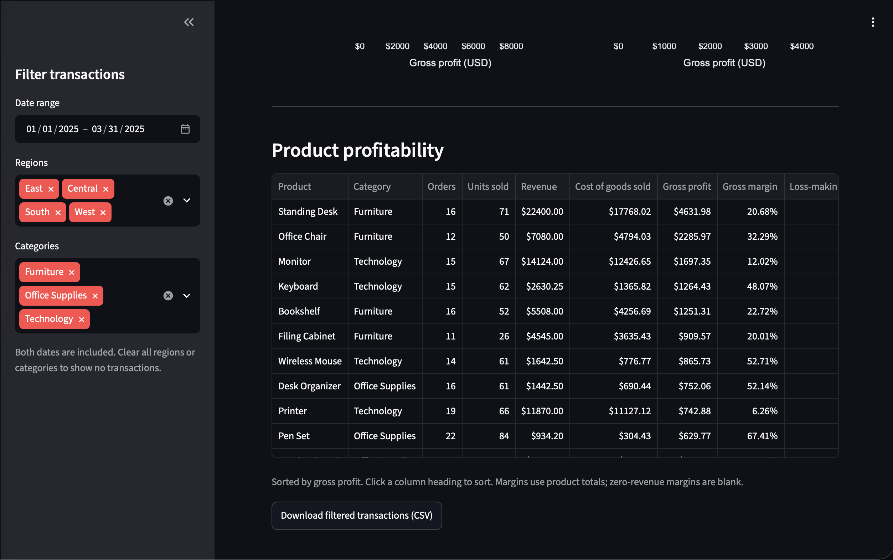
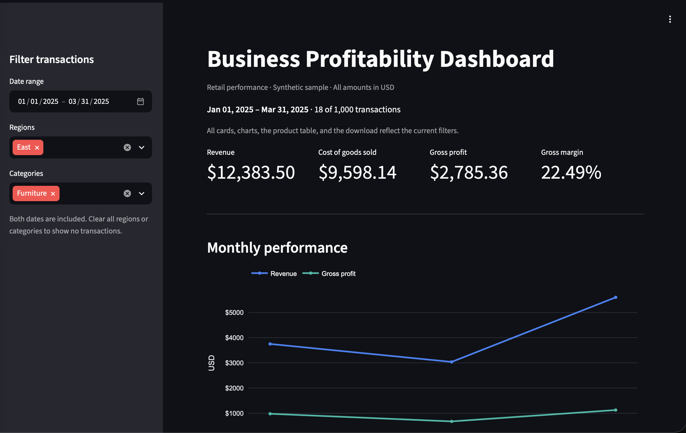

# Business Profitability Dashboard

An interactive retail analytics project that turns transaction data into revenue, cost, gross profit, and margin insights. Explore performance by date, region, category, and product, then download the selected transactions.

**[Open the live dashboard](https://parvan-profitability-dashboard.streamlit.app)**

Built with Python, pandas, Plotly, and Streamlit. Source and version history are hosted on GitHub; the dashboard is deployed on Streamlit Community Cloud.

## Business questions

- Which products and categories contribute the most gross profit?
- How do regional margins compare?
- How do revenue and gross profit change by month?
- Which transactions lose money, and how do discounts relate to margins?

## Dashboard preview

### Full-year overview



### Filtered analysis



## Dataset and results

The dataset contains **1,000 synthetic single-product orders** from January–December 2025, covering 12 products, 3 categories, 4 regions, and 3 customer segments. All amounts are USD. Data was generated with random seed 42; these are invented sample transactions, not records from a real company.

| Full-year metric | Result |
| --- | ---: |
| Revenue | $385,286.35 |
| Cost of goods sold | $305,303.59 |
| Gross profit | $79,982.76 |
| Gross margin | 20.76% |
| Loss-making transactions | 56 |

See the [dataset assumptions and column definitions](business-profitability-dashboard/data/DATASET_NOTES.md).

## Three findings

1. **Furniture contributes the most category gross profit:** $46,004.62, representing 57.52% of total gross profit, with a 21.39% gross margin.
2. **56 transactions make a gross loss:** their combined gross loss is $3,770.05. These losses are already included in the total gross profit above.
3. **South has the highest regional gross margin:** 23.27%, on $62,015.40 revenue and $14,429.82 gross profit. Product and discount mix can affect this comparison.

The [business findings report](business-profitability-dashboard/reports/business_findings.md) includes the top five products by gross profit. Six [summary tables](business-profitability-dashboard/reports) cover monthly, product, category, region, customer segment, and discount performance.

## Features

- Four metric cards: revenue, cost of goods sold, gross profit, and gross margin.
- Monthly revenue and gross profit chart, plus category and region profitability charts.
- Inclusive date-range, region, and category filters applied consistently across the dashboard.
- Sortable product table with units, order counts, financial metrics, and loss-making orders.
- CSV download containing the filtered transactions.
- Guidance for empty results and incomplete date selections.

Try January 1–March 31, 2025, **East**, and **Furniture**. Expected results: **18 orders**, **$12,383.50 revenue**, **$9,598.14 cost**, **$2,785.36 gross profit**, and **22.49% margin**.

## Financial definitions

| Metric | Calculation |
| --- | --- |
| Revenue | Quantity × unit price × (1 − discount fraction) |
| Cost of goods sold | Quantity × unit cost |
| Gross profit | Revenue − cost of goods sold |
| Gross margin | Total gross profit ÷ total revenue × 100 |

Revenue and cost are rounded per transaction to USD cents using decimal arithmetic and half-up rounding. Gross profit is their difference. Dashboard money is aggregated in integer cents before presentation. Aggregate margins use totals, not averages of row margins. Zero-revenue margins are unavailable. Gross profit excludes operating expenses, interest, and taxes.

## Run locally or in GitHub Codespaces

Python 3.12 is the deployment configuration. Clone the repository, then enter the inner project folder:

```bash
git clone https://github.com/parvanmehta12-create/business-profitability-dashboard.git
cd business-profitability-dashboard/business-profitability-dashboard
python -m pip install -r requirements.txt
python -m streamlit run app.py
```

Locally, open the URL printed by Streamlit. In Codespaces, open forwarded port 8501. Processed data is included, so regeneration is not required to view the app.

For an isolated local environment, create and activate a Python virtual environment before installing dependencies. The repository currently lists dependencies without pinned versions, so future library updates may require compatibility checks.

## Reproduce the pipeline

From the inner project folder, run these commands in order. They regenerate data and overwrite the corresponding generated outputs while preserving raw input during cleaning and calculation.

```bash
python scripts/generate_data.py
python scripts/clean_data.py
python scripts/calculate_profitability.py
python scripts/analyze_profitability.py
python scripts/verify_dashboard.py
```

| Stage | Output |
| --- | --- |
| Generate | `data/sales.csv` |
| Validate | `data/sales_clean.csv`, `data/rejected_rows.csv`, `data/validation_report.json` |
| Calculate | `data/sales_profitability.csv`, `data/profitability_summary.json`, `data/profitability_spot_checks.csv` |
| Analyze | Six summary CSVs and `reports/business_findings.md` |
| Verify | `reports/dashboard_qa.md` |

## Validation

All 1,000 source rows passed the dataset checks, with no rejected records. The [dashboard QA report](business-profitability-dashboard/reports/dashboard_qa.md) records **18 passing automated checks**, including verified totals, chart reconciliation, combined filters, product aggregation, CSV export content, inclusive date boundaries, and empty-result handling. The automated suite uses Streamlit AppTest. It does not verify browser screenshots or click a real browser download.

## Project structure

The application lives inside the inner `business-profitability-dashboard/` folder:

```text
README.md
business-profitability-dashboard/
├── app.py
├── requirements.txt
├── dashboard-overview.png
├── dashboard-filtered.png
├── data/
├── reports/
├── scripts/
└── docs/
```

Deployment entrypoint: `business-profitability-dashboard/app.py` on branch `main`. The dependency file is beside the entrypoint. Application data paths are resolved relative to `app.py`.

## Limitations and future improvements

Monthly order volumes and late-year discounts are deliberately built into the synthetic data. Discount relationships cannot establish causality or estimate price elasticity. Each row is a single-product order; multi-product orders would require line identifiers and revised duplicate rules. Returns, shipping, taxes, and operating expenses are outside the current scope.

Potential extensions include customer-segment filters, a discount-analysis view, operating-expense data, pinned dependencies, and automated GitHub Actions checks.
